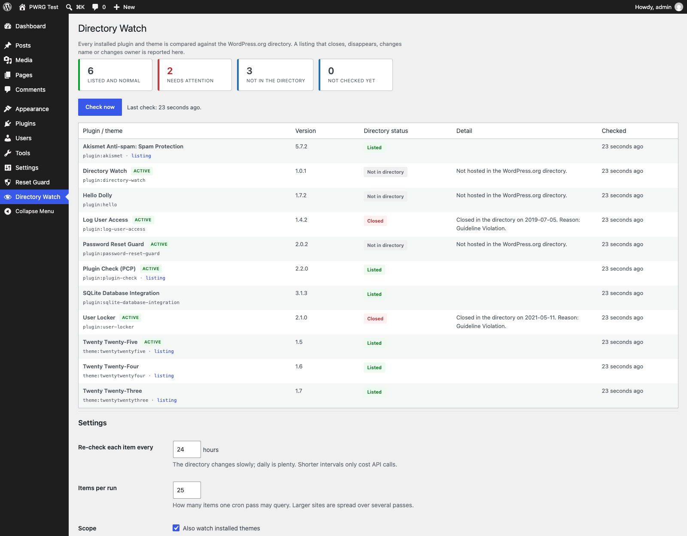
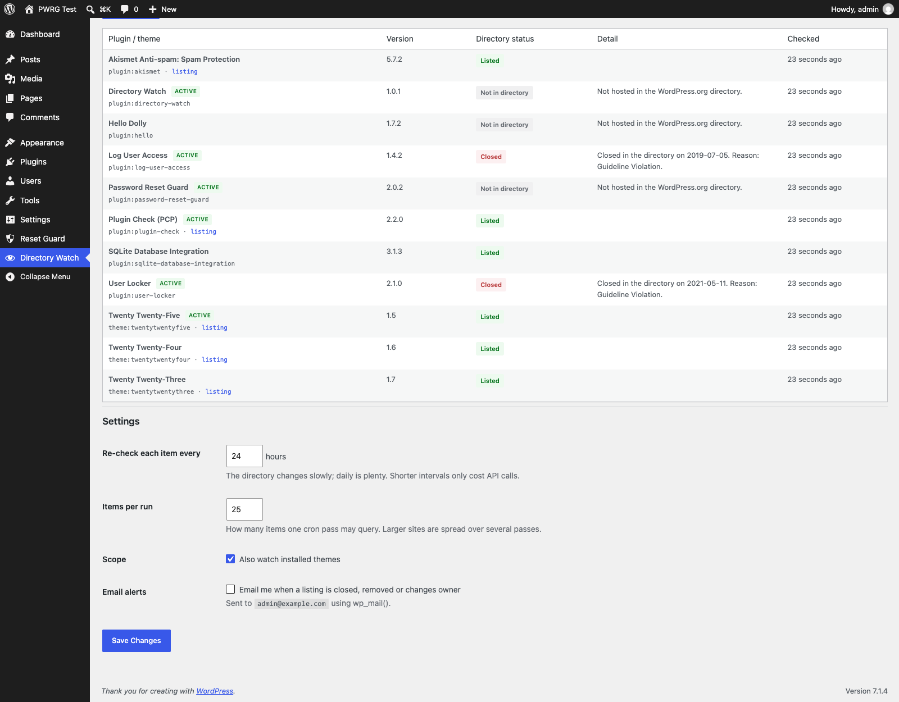

# Directory Watch

**A WordPress.org plugin that tells you when a plugin or theme you run is closed, removed, renamed or handed to a new owner.**

You installed it in 2024. It was closed for a security problem in 2026. Nothing on your site changes: the code keeps running, updates keep arriving from wherever they're hosted, and your dashboard looks exactly the same. This plugin is the missing alarm.

- No account, no cloud, no telemetry, no configuration required
- No database tables, no files written — two options, one of them autoload-disabled
- WordPress 5.8+ · PHP 7.4+ · core APIs only

---

## Screenshots

**The inventory** — every installed plugin and theme with its directory status. Closed listings carry the closure date and the reason the directory gave.



**Settings** — check interval, batch size, theme scope and email alerts. All optional; the defaults work.



---

## What it detects

| Status | Meaning | What triggers it |
|---|---|---|
| **Closed** | The directory disabled downloads for that slug. Usually a security or guideline action. The closure date and stated reason are shown. | `404` with `{"error":"closed"}` |
| **Removed** | The slug was listed before and is no longer there. | Any other API error, with a baseline saying it was previously listed |
| **New owner** | The author changed. A transfer means new code can ship under a name you already trust — the quietest way for a plugin to change hands. | Author string differs from the baseline |
| **Renamed** | The listing presents a different name. | Name differs, author unchanged |
| **Listed again** | A slug that had gone missing is back. | Previously `in_directory: 0`, now healthy |
| **Not in directory** | Custom plugins, premium bundles, marketplace themes. | Never listed, and never previously listed |

That last row is what makes the tool usable. A naive check flags every private plugin as *removed* on the first run and trains you to ignore the alarm. A slug that was never listed cannot raise one.

## How it works

1. **Inventory** — `get_plugins()` and `wp_get_themes()`, keyed `plugin:<slug>` / `theme:<slug>`, with active state taken from both `active_plugins` and the multisite network option.
2. **Due selection** — an hourly WP-Cron event, but each item is re-queried only once per `check_hours` (default 24). The cron fires constantly; real work happens once a day.
3. **Lock** — a five-minute transient, so overlapping cron ticks and a manual check cannot stack.
4. **Query** — one HTTPS GET per item to `api.wordpress.org`, with `sections`, `screenshots`, `description`, `versions`, `icons` and `banners` disabled to keep the payload small. 8 s timeout, 1 redirect, 256 KB body cap.
5. **Compare** — the fresh record against the stored baseline, with authors and names normalised (tags stripped, entities decoded, whitespace collapsed, lowercased) because the API returns author as markup.
6. **Record** — a status change appends to a 200-entry history and, for `closed` / `removed` / `transferred`, sends a single email.

A soft 20-second budget stops a batch cleanly on hosts with tight execution limits; large inventories finish over several passes instead of being killed mid-request.

### Design rules

**A transport failure is never an alert.** Timeout, HTTP 500, unparseable JSON — the previous verdict stands, the error is recorded beside the row, nothing is emailed. A flaky host cannot fabricate a closure.

**First sight never alerts.** The first pass establishes the baseline. Everything after it is real drift.

**Only `api.wordpress.org` is contacted.** The URL is built from a sanitised slug inside the plugin. No endpoint setting, no user-supplied host, no way to point it at an internal address.

## Installation

**From the admin:** Plugins → Add New → Upload Plugin → choose the zip → Install → Activate. Then open **Directory Watch** and press **Check now**.

**From git:**

```bash
cd wp-content/plugins
git clone https://github.com/deepquest-io/directory-watch.git
```

Requires outbound HTTPS to `api.wordpress.org` — the same host WordPress already contacts for update checks.

## Settings

| Setting | Default | Notes |
|---|---|---|
| Re-check interval | 24 hours | 1–168. The directory changes slowly; daily is plenty. |
| Items per run | 25 | 1–100. Larger sites spread over several cron passes. |
| Watch themes | on | Turn off for plugin-only monitoring. |
| Email alerts | **off** | Sent to the admin address via `wp_mail()`. |

## Hooks

```php
// Add a status to the ones that trigger email.
add_filter( 'dw_alert_statuses', function ( $statuses ) {
    $statuses[] = 'renamed';
    return $statuses;
} );

// Change settings at runtime without touching the option.
add_filter( 'dw_settings', function ( $settings ) {
    $settings['per_run'] = 50;
    return $settings;
} );
```

## Security

No SQL — state lives in the options API, so there is no injection surface. No filesystem writes. No `eval`, `exec`, `system` or `unserialize`. Every admin action is capability-gated on `manage_options` and nonce-verified; every output is escaped. The API host is fixed and slugs pass through `sanitize_key()`, so the client cannot be redirected (verified against traversal and full-URL payloads). Response bodies are size-capped before decoding, and an HTTP 404 is parsed rather than mistaken for a network failure.

The full review — findings, control matrix, residual risks, reproduction steps — is in [SECURITY-AUDIT.md](SECURITY-AUDIT.md). Two of the defects documented there were found by tests, and one by a live production run, not by reading the code.

Found a problem? Open an issue with steps to reproduce.

## Compatibility

WordPress 5.8+ · PHP 7.4+ · single site and multisite · no dependency on any theme, page builder or caching plugin. Uninstall removes both options, the transients and the cron event on every site of a network.

## Known limitations

- **A silent code change within a version is invisible.** Same author, same name, same version string, different code — that is a malware scanner's job.
- **Premium and custom plugins** are reported as *Not in directory*; they cannot be monitored this way.
- **A transfer that keeps the same author string** (a company account changing hands internally) is not detectable.
- **Single-file plugins whose directory slug differs from the filename** — `hello.php` is `hello-dolly` in the directory — read as *Not in directory*. It errs towards silence; multi-file plugins are unaffected.

## License

GPL-2.0-or-later. See [LICENSE](LICENSE).
